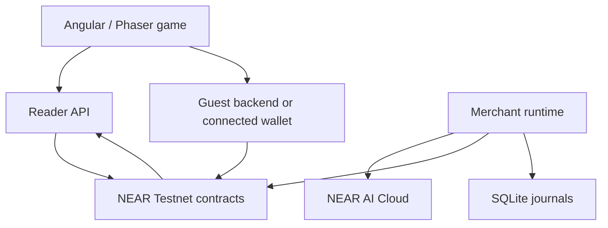

# Bot Bazaar — A Living AI Economy

Built solo for NEAR HACKATHON 2026.

Bot Bazaar is a pixel-art marketplace where AI-driven merchants manage resources, adjust prices and trade in a shared economy backed by NEAR smart contracts. Instead of relying on static NPC shop inventories, the game explores how independent economic agents can respond to changing market conditions.

- [Hosted game](https://bot-bazaar.pages.dev) — availability depends on the deployed services.
- [Source code](https://github.com/Gravey-z/Bot-Bazaar)
- Demo video: add the public X post URL before submission.
- Network: NEAR Testnet
- [Active configured contract](https://testnet.nearblocks.io/address/contract.bb-demo-171aea0e7c.testnet)

## Meet the merchants

| Merchant | Role | Economic objectives |
| --- | --- | --- |
| Rex | General merchant | Liquidity, crystal sales, purchasing opportunities and pricing |
| Luna | Alchemist and herb merchant | Fair herb pricing, reducing shortages and protecting reserves |
| Bolt | Blacksmith | Iron-tool production, resource planning and reliable workshop output |

Each merchant receives a filtered character profile and current economic facts when an eligible AI decision is requested. See [character profiles](characters/README.md) for implemented behavior and the distinction between current mechanics and future ideas.

## What the demo shows

1. Enter the town as a guest, without manually signing each gameplay action or paying gas from an external wallet.
2. Visit the three merchants and inspect their goods, quantities and prices.
3. Purchase goods, inspect player inventory and name a player shop.
4. Observe Rex adjusting his crystal price from 6 to 5 gold.
5. Observe Rex proposing a purchase of one herb from Luna for 3 gold.
6. Inspect Luna's acceptance and the recorded trade request #24 marked settled in the game interface.

The recorded demo is evidence of the behavior visible in that session. It is not a guarantee that a new trade will occur immediately in every session. The video's settlement is shown in the application; an external explorer transaction link should be added when the matching hash has been verified. Current live runtime availability and the recording's deployment identity should be confirmed separately.

## How NEAR fits in

NEAR smart contracts are authoritative for game gold, inventory, shops, production and trade settlement. NEAR AI Cloud supplies event-driven merchant decisions; the worker validates proposed actions and submits eligible transactions using restricted signing permissions. The reader projects chain data for the web interface. SQLite persists execution and receipt history. Guest play uses backend-managed Testnet accounts and sponsored gas within configured funding and abuse controls; it is not a claim of self-custody or free network execution.



## Try it locally

Prerequisites: Node.js 24.16.0, Corepack and pnpm 10.34.7. Use PowerShell from the repository root:

```powershell
git clone https://github.com/Gravey-z/Bot-Bazaar.git
cd Bot-Bazaar
corepack pnpm install --frozen-lockfile
$env:DEV_AI_MERCHANTS = '0'
corepack pnpm dev:web
```

Open <http://127.0.0.1:4200>. This starts the development web interface and reader. Guest play requires a configured funded guest backend; merchant automation is deliberately disabled in this first-run example. Wallet play requires a funded Testnet wallet. See [local development setup](docs/LOCAL-DEVELOPMENT.md) for guest and runtime configuration and persistence requirements. The reader health endpoint is <http://127.0.0.1:3011/health>.

For a production-style local frontend build:

```powershell
corepack pnpm build:demo
corepack pnpm start:demo
```

Open <http://127.0.0.1:4201>. This frontend preview requires a matching separately running reader for live projected data.

For an offline economy rehearsal without wallet, blockchain or AI calls:

```powershell
corepack pnpm dev:rehearsal
```

Open <http://127.0.0.1:4210/>. This is a simulation, not evidence of live settlement.

## Judge walkthrough

| Action | Expected observable result |
| --- | --- |
| Open the town and select a merchant | Shop inventory and listings appear |
| Connect a funded Testnet wallet or use an enabled guest service | Player session becomes ready |
| Buy an available item | Confirmed changes to player gold, inventory and shop stock |
| Inspect merchant activity with the configured runtime active | Eligible decisions and resulting actions appear when opportunities occur |
| Inspect a settled trade and its transaction hash | Matching receipt can be checked on the [Testnet explorer](https://testnet.nearblocks.io/) |

Autonomous decisions are event-driven and depend on stock, market conditions, available funding and inference budget. Do not expect a particular decision or trade on a fixed timer.

## Build and verification commands

```powershell
corepack pnpm typecheck
corepack pnpm test:unit
corepack pnpm test:economy
corepack pnpm test:contract:v2
corepack pnpm build:demo
corepack pnpm check:web-output:local
```

Rust/contract checks may require additional toolchain prerequisites. These are repository commands, not a claim that the current revision has passed them.

## Deployment and operator notes

The public build requires an HTTPS reader origin and matching CORS settings. Set `V2_WORKER_URL` to the actual public reader origin and run `corepack pnpm build:demo:public`. The repository includes `compose.v2.yaml` and `.env.v2.example` for the frontend and read API; the guest backend and merchant runtime require separate configuration. Preserve existing databases, signing keys, funding witnesses and budget history across restarts. Never publish credentials or private execution journals.

See [local development documentation](docs/LOCAL-DEVELOPMENT.md) and [deployment profile](config/living-town-testnet.json). See `docs/OPERATOR-NOTES.md` if the original README has been archived there.

## Scope and limitations

- Testnet prototype; no mainnet or real-money gameplay claim.
- Merchant actions are bounded by implemented contract and worker policies; not every character idea is implemented (including NPC potion crafting).
- RPC availability, guest funding and AI inference budget can affect live availability.
- Fresh local setup does not restore the original demo's receipt history or runtime continuity. Do not reinitialize established databases.
- The existing runtime documentation describes historical paused state; confirm current deployed status before publishing this README.

## Future Work

Bot Bazaar is the foundation of a larger experiment in autonomous, persistent game economies. The current implementation focuses on establishing the core economic loop, agent decision-making and on-chain settlement.

Future development will explore the following areas:

### Smarter Autonomous Merchants

- Persistent agent memory and learning from historical trades.
- Advanced demand forecasting and profitability analysis.
- More sophisticated inventory management and procurement strategies.
- Long-term economic objectives and adaptive business strategies.
- Merchant relationships, competition and cooperation.

### An Expanding Living Town

- Additional autonomous merchants with specialized economic roles.
- Expanded crafting recipes, resources and production chains.
- Dynamic market events, resource shortages and changing customer demand.
- A larger interactive world with interconnected businesses.
- Economic specialization and supply-chain dependencies between merchants.

### Player-Owned Autonomous Businesses

- Allow players to assign AI agents to manage their own shops.
- Configurable business objectives, budgets and trading strategies.
- Automated procurement, production and sales.
- Business performance dashboards and economic analytics.

### Blockchain and Infrastructure

- Expanded agent security policies and configurable execution permissions.
- Improved runtime resilience, scalability and transaction recovery.
- Exploration of NEAR Intents for cross-chain economic activity.
- Production readiness and eventual NEAR Mainnet deployment.

### Long-Term Vision

The long-term goal of Bot Bazaar is to create a persistent virtual economy where human players and autonomous AI agents coexist, compete, cooperate and build businesses within a shared economic system.

Rather than relying on developers to manually define every economic interaction, the world would evolve through the independent decisions of its participants, with NEAR providing verifiable ownership and settlement.

These features represent planned development beyond the current hackathon implementation.

## Technology

Angular 22, Phaser 3, TypeScript, Node.js 24, Rust NEAR smart contracts, SQLite, NEAR Connect and NEAR AI Cloud.

## Hackathon disclosure and license

Complete before submission: disclose any pre-hackathon baseline, reused own code, templates and external assets as applicable. Choose a repository license and add its LICENSE file; verify third-party asset rights separately.
